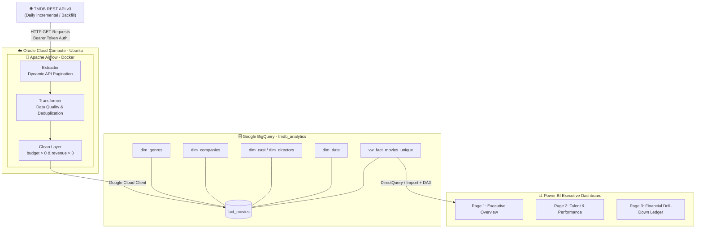
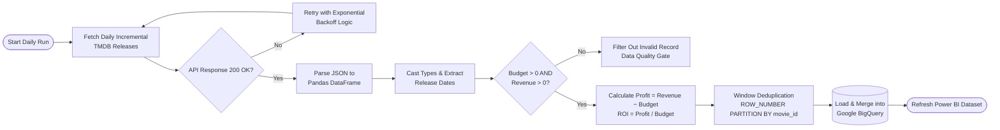
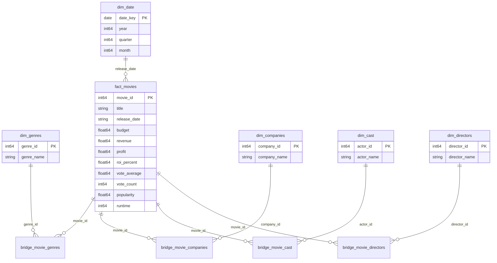
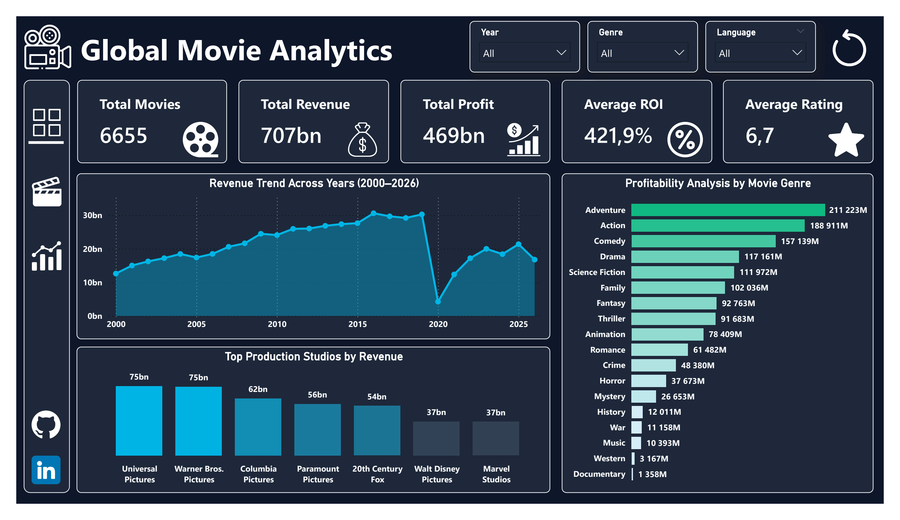
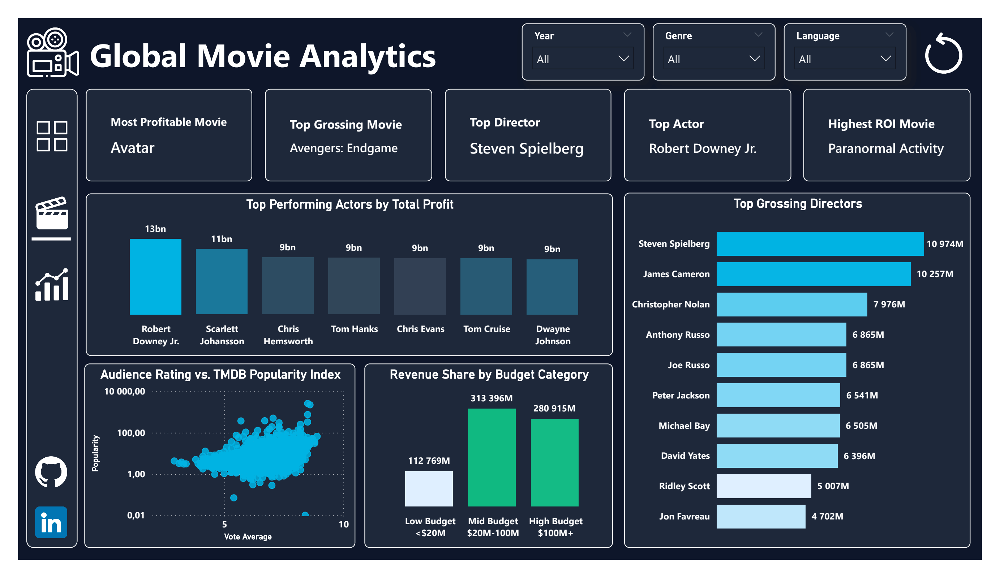

<div align="left">

# 🎬 Global Movie Analytics Pipeline & Executive System

### Automated End-to-End TMDB Movie Data Engineering & Financial Intelligence Platform

*From REST API feeds to executive decision support: Airflow → BigQuery → Power BI*


[Overview](#-overview) •
[Architecture](#-system-architecture) •
[Data Model](#-data-warehouse-star-schema) •
[Dashboard](#-power-bi-dashboard) •
[Insights](#-key-analytical-findings) •
[Quick Start](#-quick-start) •
[Roadmap](#-roadmap)

</div>

---

## 📑 Table of Contents

- [Overview](#-overview)
- [Executive Summary \& Key Metrics](#-executive-summary--key-metrics)
- [System Architecture](#-system-architecture)
- [Pipeline Logic (ETL)](#-pipeline-logic-etl)
- [Key Engineering Features](#-key-engineering-features)
- [Data Warehouse (Star Schema)](#-data-warehouse-star-schema)
- [Power BI Dashboard](#-power-bi-dashboard)
- [Key Analytical Findings](#-key-analytical-findings)
- [Tech Stack](#-tech-stack)
- [Quick Start](#-quick-start)
- [Configuration](#-configuration)
- [Repository Structure](#-repository-structure)
- [Engineering Challenges \& Solutions](#-engineering-challenges--solutions)
- [Roadmap](#-roadmap)
- [Troubleshooting](#-troubleshooting)
- [Security](#-security)
- [Author](#-author)

---

## 🎯 Overview

An enterprise-grade, automated data engineering and business intelligence solution that **extracts, cleanses, transforms, warehouses, and visualizes global movie box-office telemetry** sourced from The Movie Database (TMDB) API:

| Data Layer | Description / Purpose |
|:----:|---------|
| **TMDB REST API** | Automated dynamic REST API endpoint fetching movie metadata, financial records, cast, crew, and studios. |
| **Data Quality Gate** | Strictly enforces financial integrity by filtering records (`budget > 0 AND revenue > 0`). |
| **BigQuery DWH** | Normalized Star Schema data warehouse (`tmdb-movie-analytics.tmdb_analytics`). |
| **Power BI UI** | Executive 3-page dark-themed analytical dashboard (`#0F172A`). |

A containerized **Apache Airflow** DAG runs on **Oracle Cloud Infrastructure (OCI)**, ingests incremental daily updates, transforms raw JSON payloads with **Python / Pandas**, updates a **Star Schema Data Warehouse in Google BigQuery**, and powers an executive **Power BI** dashboard with custom DAX measures.

---

## 📌 Executive Summary & Key Metrics

The pipeline continuously evaluates commercial film industry performance, tracking gross box-office revenues, net profit margins, studio market share, and talent profitability across releases from 2000 to 2026.

| Metric | Value |
|--------|------:|
| 🎬 Verified Commercial Movies | **6,655 films** |
| 💰 Cumulative Global Box Office | **\$707 Billion** |
| 📈 Cumulative Net Industry Profit | **\$469 Billion** |
| 📊 Net Profitability Margin | **66.35%** |
| ⚖️ Portfolio Profit/Loss Ratio | **73.36% Profitable / 26.64% Loss-making** |
| 🚀 Average Return on Investment (ROI) | **421.9%** |

---

## 🏗️ System Architecture



---

## ⚙️ Pipeline Logic (ETL)



---

## 🌟 Key Engineering Features

<table>
<tr>
<td width="50%" valign="top">

### 🔒 Strict Data Quality Gate
Filters out millions of incomplete or unverified records (`budget = 0` or `revenue = 0`) to protect corporate financial metrics (ROI %, Net Profit Margin) from extreme visual skewing.

</td>
<td width="50%" valign="top">

### 🔄 Incremental Daily Orchestration
Engineered with Apache Airflow on OCI. Performs lightweight daily incremental syncs rather than costly full table refreshes, saving cloud storage & compute budget.

</td>
</tr>
<tr>
<td width="50%" valign="top">

### ⚡ Idempotent Window Deduplication
Employs BigQuery window functions (`ROW_NUMBER() OVER (PARTITION BY movie_id ORDER BY popularity DESC)`) inside the analytical view layer to guarantee zero data duplication on pipeline re-runs.

```sql
ROW_NUMBER() OVER (
    PARTITION BY movie_id 
    ORDER BY popularity DESC
) AS rn
```

</td>
<td width="50%" valign="top">

### 📐 Logarithmic Scale UI Optimization
Configured logarithmic scale axes (`0.01` to `10,000.00`) on scatter plots (`Audience Rating vs. TMDB Popularity`) to eliminate data point clustering caused by outlier hit titles.

</td>
</tr>
</table>

---

## 🗄️ Data Warehouse (Star Schema)

The BigQuery Data Warehouse (`tmdb-movie-analytics.tmdb_analytics`) is architected as an OLAP **Star Schema** with explicit Bridge tables for Many-to-Many entities.



<details>
<summary><b>📖 Data Dictionary (click to expand)</b></summary>

<br/>

| Table | Column | Description |
|-------|--------|-------------|
| `fact_movies` | `movie_id` | Primary key identifier for films |
| `fact_movies` | `budget` / `revenue` / `profit` | Financial metrics (USD) |
| `fact_movies` | `roi_percent` | Calculated Return on Investment percentage |
| `fact_movies` | `vote_average` / `vote_count` | User audience rating score & total vote volume |
| `fact_movies` | `popularity` | Dynamic TMDB popularity index metric |
| `bridge_movie_cast` | `movie_id`, `actor_id` | M:N Bridge mapping actors to movies |
| `bridge_movie_directors` | `movie_id`, `director_id` | M:N Bridge mapping directors to movies |
| `bridge_movie_genres` | `movie_id`, `genre_id` | M:N Bridge mapping genres to movies |
| `bridge_movie_companies` | `movie_id`, `company_id` | M:N Bridge mapping studios to movies |
| `vw_fact_movies_unique` | `budget_category` | Categorical tier: Low (<$20M), Mid ($20M-100M), High ($100M+) |

</details>

---

## 📊 Power BI Dashboard

The Power BI platform delivers an executive **3-page interactive decision support system** using custom dark themes (`#0F172A`) and advanced DAX measures.

### 📄 Page 1 · Executive Overview



- **Top KPI Strip:** Total Movies (**6,655**), Total Revenue (**$707bn**), Total Profit (**$469bn**), Avg ROI (**421.9%**), Avg Rating (**6.7**).
- **Macro Trends:** Annual Box-Office Revenue Trend (2000–2026) illustrating the 2020 COVID-19 contraction ($4.49B) and subsequent industry recovery.
- **Breakdown Visuals:** Profitability analysis by Genre alongside Top Production Studios by total gross revenue.

### 📄 Page 2 · Talent & Performance Analytics



- **Talent Benchmarks:** Highest grossing and most profitable Directors (*Steven Spielberg*, *James Cameron*) and Actors (*Robert Downey Jr.*, *Chris Hemsworth*).
- **Logarithmic Scatter:** Log-scale plot evaluating Audience Rating vs. TMDB Popularity Index without data density overlap.
- **Budget Categorization:** Segmented financial revenue share across High Budget ($100M+), Mid Budget ($20M-$100M), and Low Budget (<$20M).

### 📄 Page 3 · Financial Drill-Down Ledger


- **Portfolio Outcome:** Donut chart breakdown of **73.36% Profitable** vs. **26.64% Loss-making** commercial releases.
- **Top Financial Performers:** Visual highlight of all-time box-office records (*Avatar* - $2.7B profit, *Avengers: Endgame* - $2.6B profit).
- **Ad-hoc Financial Ledger:** Searchable matrix table with title search filters, release dates, financial totals, ROI percentages, and conditional color indicators.

<details>
<summary><b>🧠 Example DAX Measures (click to expand)</b></summary>

```dax
Total Revenue = SUM ( 'vw_fact_movies_unique'[revenue] )

Total Profit = SUM ( 'vw_fact_movies_unique'[profit] )

Profit Margin % = 
DIVIDE ( 
    [Total Profit], 
    [Total Revenue], 
    0 
)

Average ROI % = 
AVERAGE ( 'vw_fact_movies_unique'[roi_percent] )

Profitable Movies % = 
VAR TotalCount = COUNTROWS('vw_fact_movies_unique')
VAR ProfitableCount = 
    CALCULATE(
        COUNTROWS('vw_fact_movies_unique'), 
        'vw_fact_movies_unique'[profit] > 0
    )
RETURN 
    DIVIDE(ProfitableCount, TotalCount, 0)
```

</details>

---

## 🔍 Key Analytical Findings

> Insights derived from SQL queries in [`sql/analytical_queries.sql`](sql/analytical_queries.sql).

| # | Finding | Detail |
|:-:|---------|--------|
| 1 | **Director Commercial Power** | **James Cameron** leads all-time director profitability ($161.36B profit across 9 films), averaging **$1.53B net profit per movie**. |
| 2 | **Budget Tier Resiliency** | **High Budget ($100M+)** films command the highest profit margin (**66.49%**), while **Mid Budget ($20M-100M)** provides overall industry volume ($187.5B profit). |
| 3 | **Studio Market Concentration** | **Warner Bros. Pictures** ($598.8B revenue) and **Universal Pictures** ($500.5B revenue) lead total volume, while **Marvel Studios** dominates yield per release ($391.8B profit across just 54 films). |

<details>
<summary><b>🧾 Sample query: Top Directors Profitability (click to expand)</b></summary>

```sql
SELECT 
    d.director_name,
    COUNT(DISTINCT f.movie_id) AS total_movies_directed,
    SUM(f.revenue) AS total_revenue,
    SUM(f.profit) AS total_profit,
    ROUND(AVG(f.profit), 2) AS avg_profit_per_movie
FROM `tmdb-movie-analytics.tmdb_analytics.vw_fact_movies_unique` f
JOIN `tmdb-movie-analytics.tmdb_analytics.bridge_movie_directors` bd ON f.movie_id = bd.movie_id
JOIN `tmdb-movie-analytics.tmdb_analytics.dim_directors` d ON bd.director_id = d.director_id
GROUP BY d.director_name
HAVING COUNT(DISTINCT f.movie_id) >= 3
ORDER BY total_profit DESC
LIMIT 10;
```

</details>

---

## 🧰 Tech Stack

| Layer | Technology |
|-------|------------|
| **Data Source** | TMDB REST API v3 |
| **Orchestration** | Apache Airflow 2.7 (Docker) |
| **Infrastructure** | Oracle Cloud Infrastructure (Ubuntu Compute) |
| **Transformation** | Python 3.10, Pandas |
| **Data Warehouse** | Google BigQuery (Star Schema) |
| **Analytics** | SQL (BigQuery Standard SQL) |
| **BI & Visualization** | Power BI, DAX |
| **Containerization** | Docker, Docker Compose |

---

## 🚀 Quick Start

### Prerequisites

- 🐳 Docker & Docker Compose
- ☁️ Google Cloud Platform account with BigQuery enabled
- 🔑 TMDB API Read Access Token / API Key
- 🐍 Python 3.10+

### Installation

**1️⃣ Clone the repository**

```bash
git clone https://github.com/nihatrzaguluzada/global-movie-analytics-pipeline.git
cd global-movie-analytics-pipeline
```

**2️⃣ Configure GCP Service Account Credentials**

```bash
mkdir -p config
cp /path/to/your-gcp-key.json config/gcp_key.json
```

**3️⃣ Deploy the containerized Airflow stack**

```bash
docker-compose up -d
```

**4️⃣ Initialize the BigQuery schema & views**

Run the setup scripts via the Google Cloud Console SQL Editor or `bq` CLI:

```bash
bq query --use_legacy_sql=false < sql/schema.sql
```

**5️⃣ Trigger the Airflow DAG**

Access Airflow UI at **http://localhost:8080** (`airflow` / `airflow`) and enable `tmdb_incremental_dag`.

---

## 🔧 Configuration

| Item | Location | Description |
|------|----------|-------------|
| GCP Credentials | `config/gcp_key.json` | Service account key with BigQuery Data Editor permissions |
| TMDB API Key | `.env` / Airflow Variables | Bearer API token for TMDB REST service |
| BigQuery Dataset | `sql/schema.sql` | `tmdb-movie-analytics.tmdb_analytics` |
| Airflow DAG ID | `dags/tmdb_incremental_dag.py` | `tmdb_incremental_pipeline` |

---

## 📁 Repository Structure

```text
global-movie-analytics-pipeline/
├── dags/
│   └── tmdb_incremental_dag.py        # Apache Airflow Daily Incremental ETL DAG
├── scripts/
│   └── tmdb_bigquery_etl.py           # Python Ingestion & Transformation Script
├── sql/
│   ├── schema.sql                     # BigQuery Star Schema DDL & Analytical View
│   └── analytical_queries.sql         # Top 7 Production Analytical SQL Queries
├── power_bi/
│   ├── Global_Movie_Analytics.pbix    # Interactive Power BI Report File
│   └── dashboard_screenshots/         # High-Resolution UI Snapshots
│       ├── page1_executive_overview.png
│       ├── page2_talent_performance.png
│       └── page3_financial_ledger.png
├── docker-compose.yaml                # Airflow Stack Container Definition
├── requirements.txt                   # Python Runtime Dependencies
├── .gitignore                         # Security & Exclusion Rules
└── README.md                          # Project Documentation
```

---

## 🧩 Engineering Challenges & Solutions

| Challenge | Solution |
|-----------|----------|
| Incomplete API records distorting financial KPIs | Implemented Data Quality Gate (`budget > 0 AND revenue > 0`) in view layer |
| API rate limits and long historical pagination | Modular batch extraction with exponential retry backoff |
| Duplicate entity entries during incremental runs | Idempotent deduplication via BigQuery window functions (`ROW_NUMBER()`) |
| Visual cluster overlap on scatter charts | Applied Logarithmic scale Y-axis formatting (`0.01` to `10,000.00`) |
| Complex many-to-many metadata relationships | Modeled explicit Star Schema bridge tables for cast, directors, studios & genres |

---

## 🗺️ Roadmap

- [x] TMDB API historical backfill & daily incremental pipeline
- [x] Google BigQuery Star Schema Data Warehouse
- [x] 3-page Power BI executive dark-mode dashboard
- [x] 7 Enterprise SQL analytical business queries
- [ ] Automated dbt (data build tool) testing & data lineage documentation
- [ ] Real-time Slack / Telegram alerting on pipeline DAG failure
- [ ] Machine Learning predictive model for predicting movie box-office ROI
- [ ] GitHub Actions CI/CD pipeline for automated SQL quality validation

---

## 🛠️ Troubleshooting

<details>
<summary><b>Airflow webserver is unreachable at localhost:8080</b></summary>

Verify Docker container status and review runtime logs:

```bash
docker-compose ps
docker-compose logs -f airflow-webserver
```

</details>

<details>
<summary><b>BigQuery Access Denied / Permission Error</b></summary>

Ensure your `config/gcp_key.json` service account holds **BigQuery Data Editor** and **BigQuery Job User** IAM roles.

</details>

---

## 🔒 Security

Protect API keys and Cloud credentials by adding the following rules to `.gitignore`:

```text
# GCP Credentials & API Keys
*.json
config/gcp_key.json
.env

# Python & Airflow Artifacts
__pycache__/
*.pyc
logs/
.pytest_cache/

# OS System Files
.DS_Store
Thumbs.db
```

---

## 👤 Author

**Nihat Rzaguluzada | Data Analyst & Data Engineer Specialist**

Developed as an enterprise-grade **Data Engineering & Business Intelligence portfolio project** demonstrating proficiency in Python ETL, Cloud Data Warehousing (BigQuery), Apache Airflow orchestration, SQL analytics, and Power BI visualization.

[](https://github.com/nihatrzaguluzada)
[](https://www.linkedin.com/in/nihat-rzaguluzada/)
